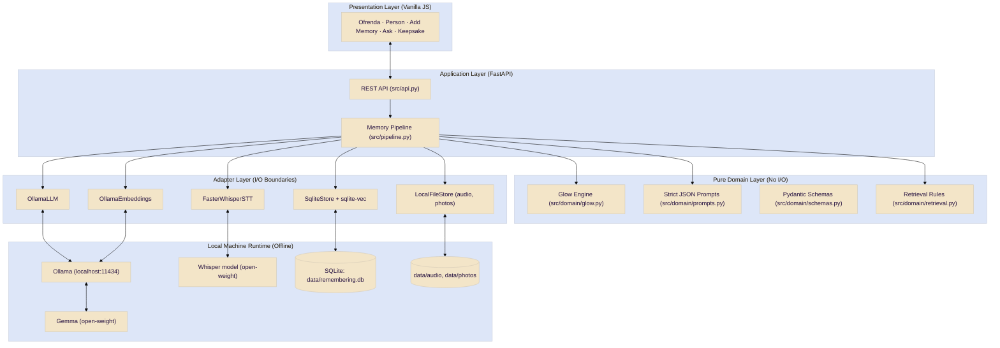
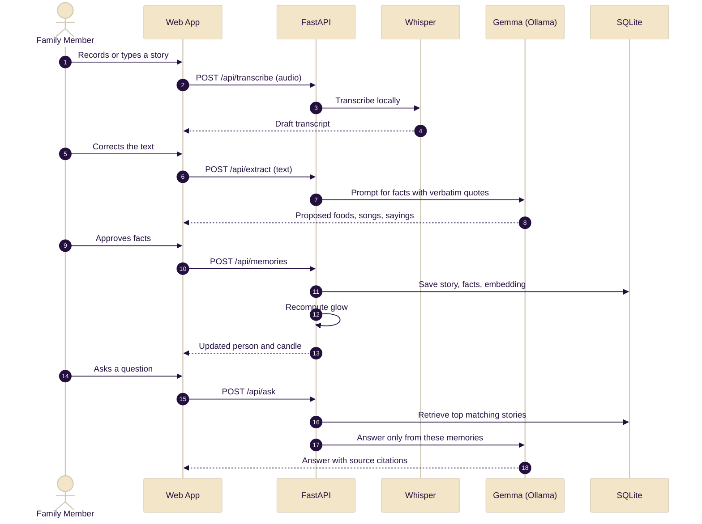

# The Last Remembering 🕯️

**A private, offline family memory keeper inspired by the Día de los Muertos ofrenda. Record the stories of the people you love, light a candle for each of them, and ask questions that are answered only from what you have saved.**


---

## 🌼 Overview

Every autumn, families who observe Día de los Muertos build an **ofrenda**: an altar of marigolds, candles, favorite foods, and photographs that welcomes loved ones back for a night. The idea behind it is simple and powerful: a person is never truly gone while someone still remembers them.

**The Last Remembering** carries that idea into a small local application. You add the stories, songs, recipes, and sayings of the people in your life. Each person gets a portrait and a candle on a stepped altar, and the candle glows brighter every time you add or revisit a memory. If a name goes unvisited for too long, the flame dims and the app gently invites you to add a story.

Everything runs on your own machine with open-weight models. Recordings of your family never leave your laptop, the app works with the internet off, and your archive is a folder of plain files that no service shutdown can take away.

> **A note on the tradition.** Día de los Muertos is a living Mexican tradition. The author is not from this tradition and was introduced to the idea through popular culture. This project is an attempt to honor the people in the author's own life, using the tradition's imagery with respect and not as a costume. Corrections and guidance from people who observe it are warmly welcomed.

---

## 🌟 Key Features

### 1. The Living Ofrenda
- A three-tier altar with an arched portrait for each person, framed in marigolds and hung with papel picado.
- A **glow engine** that raises each candle as you add memories and dims it as time passes without a visit.
- Optional photo upload for each portrait, stored locally.

### 2. Local Voice Capture and Transcription
- Record a relative telling a story straight from the browser.
- **Whisper** transcribes it on your machine. You review and correct the text before anything is saved.

### 3. Fact Extraction You Approve
- A local **Gemma** model proposes foods, songs, sayings, and places mentioned in each story.
- Every suggestion includes the exact quote it came from, and nothing is stored until you approve it.

### 4. Ask a Memory (Retrieval, Never Impersonation)
- Ask natural questions such as "What did Abuelo sing in the truck?"
- Answers are built **only** from retrieved stories and link back to the exact source memory.
- If nothing relevant exists, the app says so plainly: *"I don't have a memory of that yet."*
- The model never speaks as the person and never invents family history.

### 5. Printable Keepsakes
- Generate a remembrance page for each person with their portrait, a story excerpt, and their favorite things, ready to print and place beside the candle.

### 6. 100% Offline and Private
- No telemetry, no cloud APIs, and no accounts. Weights, database, audio, and photos all live in one local data folder.

---

## 🧭 Design Principles

| Principle | What it means in practice |
|---|---|
| **Retrieval, not impersonation** | The model answers from saved stories and cites them. It never role-plays a deceased person. |
| **Human in the loop** | Transcripts and extracted facts are always shown for approval, so the app never silently writes family history. |
| **Local-first** | No network calls at runtime after models are downloaded. Data stays in files you own. |
| **Respectful by design** | Imagery draws on the tradition itself and not on any film, character, or studio. |

---

## 🏗️ Architecture & Data Flow

The project separates the **Domain** (pure logic with no I/O) from **Adapters** (speech, language model, embeddings, storage), so any piece can be swapped without touching the rest.



### Memory Lifecycle



---

## 🕯️ The Glow Engine

Each person has a glow score from 0 to 100 that drives their candle.

```text
glow = clamp( 20 + 12 × min(stories, 5) + 2 × min(facts, 10) − 0.5 × days_since_last_touch , 0, 100 )
```

| Glow | Candle |
|---|---|
| 76 – 100 | Burning bright |
| 46 – 75 | Glowing |
| 21 – 45 | Fading |
| 0 – 20 | Nearly dark |

All weights live in configuration, so the curve is easy to tune.

---

## 🛠️ Open-Weight & Open-Source Stack

| Component | Technology | Type | Why It Was Chosen |
|---|---|:---:|---|
| **Language Model** | [Gemma](https://ollama.com/library/gemma3) via Ollama | Open-Weight | Strong instruction following at small sizes, runs on a laptop, and handles strict JSON output well. |
| **Speech-to-Text** | [faster-whisper](https://github.com/SYSTRAN/faster-whisper) with [Whisper](https://github.com/openai/whisper) | Open-Weight | Accurate local transcription, including accented and multilingual speech. |
| **Embeddings** | [nomic-embed-text](https://ollama.com/library/nomic-embed-text) | Open-Weight | Small, fast embeddings so questions can find the right story. |
| **Local Inference** | [Ollama](https://ollama.com/) | Open-Source | One simple local server for language and embedding models. |
| **Backend API** | [FastAPI](https://fastapi.tiangolo.com/) + Uvicorn | Open-Source | Async Python server with typed request and response models. |
| **Database** | [SQLite](https://www.sqlite.org/) | Open-Source | A single portable file you can back up by copying it. |
| **Vector Search** | [sqlite-vec](https://github.com/asg017/sqlite-vec) | Open-Source | Vector search inside the same SQLite file, with no extra service. |
| **Frontend** | HTML, CSS, and vanilla JavaScript | Open-Source | No build step, easy to read, and easy to port to a framework later. |
| **Typography** | [Cormorant Garamond](https://fonts.google.com/specimen/Cormorant+Garamond) + [Inter](https://rsms.me/inter/) | Open-Source | Open-licensed fonts for a refined editorial look. |

### Why Open Models?

- **Private.** Voices, photos, and stories about your family never reach a server you do not control.
- **Offline.** The whole app works at a family gathering with no Wi-Fi.
- **Durable.** Weights, database, audio, and photos are plain local files. No company shutdown or pricing change can erase them, which is the "final death" idea made literal.
- **Swappable.** Change the model in one line of configuration and compare how different models answer the same questions.
- **Free to run.** No API keys, subscriptions, or per-token costs.

---

## 🚀 Quick Start Guide

> **Status:** the interface prototype is complete and runs on sample data. The backend described below is the build target for connecting it to real models.

### Prerequisites
- Python 3.11+
- [Ollama](https://ollama.com/) installed and running
- About 4 GB of free disk space for models

### 1. Pull the Local Models
```bash
ollama pull gemma3:4b
ollama pull nomic-embed-text
```
*(On a lighter machine you can use a smaller Gemma such as `gemma2:2b`.)*

### 2. Configure Environment
```bash
git clone https://github.com/YOUR_USERNAME/the-last-remembering.git
cd the-last-remembering
cp .env.example .env
```
Default `.env` settings:
```env
LLM_BASE_URL=http://localhost:11434/v1
LLM_API_KEY=ollama
LLM_MODEL=gemma3:4b
EMBED_MODEL=nomic-embed-text
WHISPER_MODEL=small
WHISPER_DEVICE=cpu
DATA_DIR=./data
TOP_K=4
MIN_RELEVANCE=0.35
```

### 3. Start the Backend
```bash
python -m venv .venv
# Windows:
.venv\Scripts\activate
# Mac/Linux:
source .venv/bin/activate

pip install -r requirements.txt
uvicorn src.api:app --reload --host 127.0.0.1 --port 8000
```
The Whisper model downloads once on first use, then everything runs offline.

### 4. Open the App
Serve the `frontend/` folder, or simply open `frontend/index.html` in your browser, and visit **`http://localhost:8000`**.

---

## 🔌 API Overview

| Method | Endpoint | Purpose |
|---|---|---|
| `GET` | `/api/people` | List people with their current glow |
| `POST` | `/api/people` | Create a person |
| `POST` | `/api/people/{id}/photo` | Upload a portrait |
| `POST` | `/api/transcribe` | Transcribe an audio recording locally |
| `POST` | `/api/extract` | Propose facts from a story, each with a verbatim quote |
| `POST` | `/api/memories` | Save an approved story and its facts |
| `POST` | `/api/ask` | Answer a question from saved memories, with citations |
| `GET` | `/api/people/{id}/keepsake` | Data for the printable remembrance page |
| `GET` | `/api/health` | Check Ollama and model availability |

Full request and response shapes are in [`docs/INTEGRATION_SPEC.md`](docs/INTEGRATION_SPEC.md).

---

## 🧪 Running Tests

```bash
pytest tests/ -v
```
Tests cover the glow engine, fact-quote validation, the retrieval refusal rule, and the API contract using a fake LLM adapter, so they run without Ollama.

---

## 📂 Repository Structure

```text
the-last-remembering/
├── frontend/                        # Web application
│   ├── index.html                   # Single-page app (hash routing)
│   └── assets/                      # Fonts, icons, optional local images
├── src/
│   ├── adapters/                    # I/O Adapters
│   │   ├── stt_faster_whisper.py    # Local speech-to-text
│   │   ├── llm_ollama.py            # Ollama chat client with retry and JSON repair
│   │   ├── embed_ollama.py          # Local embeddings
│   │   ├── store_sqlite.py          # SQLite + sqlite-vec storage
│   │   └── files_local.py           # Audio and photo storage
│   ├── domain/                      # Pure Domain Logic (Zero I/O)
│   │   ├── glow.py                  # Candle score and status
│   │   ├── prompts.py               # Strict JSON prompts
│   │   ├── retrieval.py             # Top-k, threshold, and refusal rule
│   │   └── schemas.py               # Pydantic models
│   ├── api.py                       # FastAPI endpoints
│   ├── config.py                    # Environment settings
│   └── pipeline.py                  # Transcribe, extract, save, and ask orchestration
├── data/                            # Your private archive (git-ignored)
│   ├── remembering.db
│   ├── audio/
│   └── photos/
├── docs/
│   └── INTEGRATION_SPEC.md          # Build brief for connecting the UI to real models
├── tests/
└── requirements.txt
```

---

## 🗺️ Roadmap

- [x] Interface prototype with sample data (Next.js component-based frontend)
- [x] Local transcription with Whisper
- [x] Fact extraction with verbatim quote verification (C5)
- [x] Retrieval-based Q&A with citations and refusal rules (C2/C3)
- [x] Persistent SQLite storage, photo upload, and glow engine
- [x] Printable keepsake export
- [x] Gentle reminders for fading candles
- [x] Optional narration of remembrances with local offline audio
- [x] Portable `.ofrenda` archive export & import (`scripts/export_archive.py`)
- [x] Automated test suite & CI workflow (`.github/workflows/ci.yml`)
- [ ] Model comparison view (swap Gemma sizes and compare answers)

---

## 📜 Credits and Licenses

| Component | Project / Model | Author | License |
| :--- | :--- | :--- | :--- |
| Project Code | The Last Remembering | YOUR_NAME | MIT |
| LLM Weights | Gemma | Google DeepMind | Gemma Terms of Use |
| Speech Model | Whisper | OpenAI | MIT |
| Speech Runtime | faster-whisper | SYSTRAN | MIT |
| Embeddings | nomic-embed-text | Nomic AI | Apache-2.0 |
| Local Inference | Ollama | Ollama Team | MIT |
| Vector Search | sqlite-vec | Alex Garcia | MIT / Apache-2.0 |
| Web API | FastAPI | Sebastián Ramírez | MIT |
| Fonts | Cormorant Garamond, Inter | Christian Thalmann, Rasmus Andersson | SIL Open Font License |

Please verify each license against the version you ship. Project source code is released under the [MIT License](LICENSE).

---

*Made with respect for the people we remember. Hecho con cariño.*
